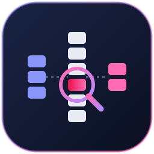
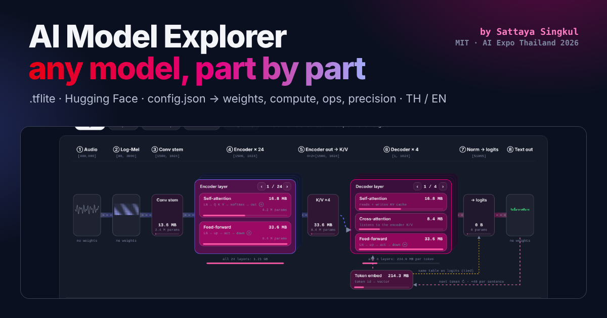
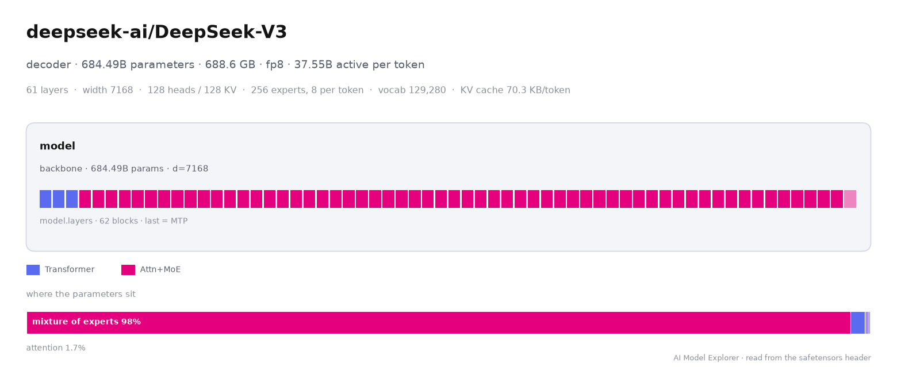

<p align="center">
  
</p>

<h1 align="center">AI Model Explorer</h1>

<p align="center"><b>See inside any AI model on Hugging Face, part by part, without downloading the weights.</b></p>

<p align="center">
  <a href="https://pypi.org/project/ai-model-explorer/"></a>
  <a href="https://pypi.org/project/ai-model-explorer/"></a>
  <a href="LICENSE"></a>
  <a href="https://www.researchgate.net/publication/417293353_Reading_the_Architecture_off_the_Weights_Manifest-Only_Recovery_of_Neural_Network_Anatomy"></a>
</p>

<p align="center">
  <a href="https://joessattes.github.io/ai-model-explorer/en/"><b>Open the web app</b></a> ·
  <a href="https://joessattes.github.io/ai-model-explorer/">ภาษาไทย</a> ·
  <a href="#what-is-new-here">What is new</a> ·
  <a href="docs/usage.md">Docs</a> ·
  <a href="docs/how-it-works.md">How it works</a> ·
  <a href="https://www.researchgate.net/publication/417293353_Reading_the_Architecture_off_the_Weights_Manifest-Only_Recovery_of_Neural_Network_Anatomy">Paper</a>
</p>



## What it is
AI Model Explorer works out a model's architecture from its weight manifest, the list of tensor names, shapes and
types at the start of every safetensors file. It reads that header (a few tens of kilobytes, even for models of
hundreds of gigabytes) and shows what the model is made of: its components, the repeated layers and what each one
does, how the parts connect, the exact parameter count and how every tensor is stored. It runs as a web page, a
command-line tool and a Python library.

## Why use it
- **Know a model before you download it.** DeepSeek-V3 is 689 GB of weights. Its anatomy takes 12 MB of headers and a few seconds.
- **Plan quantization and edge deployment.** See which parts hold the parameters, which layers carry a KV cache, and how each tensor is already stored (FP8, NVFP4, GPTQ, AWQ, MXFP4, MLX, bitsandbytes).
- **Understand new architectures quickly.** Hybrid attention / state-space / mixture-of-experts stacks, multi-token-prediction layers, vision and audio encoders feeding an LLM: each is labelled, with the evidence behind the label.
- **Check what a model card or config claims.** Parameter totals come from the weights, and `config.json` is checked against them.
- **Script it.** `pip install ai-model-explorer` gives a CLI and a Python API: insights, memory estimates, side-by-side comparisons, diagrams as PNG/SVG/PDF and HTML reports, all returning plain data for batch analysis or AI agents.
- **Private by design.** Files you open are parsed in your browser or on your machine. No server, no upload.

## Quick start
**Web.** Open https://joessattes.github.io/ai-model-explorer/en/, type a repo id such as `Qwen/Qwen3-8B` and press Load.
Links like [`…/en/#hf=deepseek-ai/DeepSeek-V3`](https://joessattes.github.io/ai-model-explorer/en/#hf=deepseek-ai/DeepSeek-V3) open a model directly.

**Command line.**
```bash
pip install ai-model-explorer
ai-model-explorer inspect deepseek-ai/DeepSeek-V3
```
```
deepseek-ai/DeepSeek-V3
  family decoder · 684.49B parameters · 688.6 GB of weights · stored as fp8
  read 11.9 MB from 163 file(s), 91991 tensors
  width 7168 · layers 61 · heads 128 · kv heads 128 · head dim 128 · ffn 18432 · experts 256 · active experts 8 · vocab 129280
  components:
    (root) (backbone) · d=7168
      model.layers: 62 blocks · Transformer ×3, Attn+MoE ×58, Attn+MoE ×1 (last one is a multi-token-prediction layer)
  config.json: agrees with the weights
```
Add `--json` for everything, `--tensors` for the role of every tensor, or run `ai-model-explorer open` to start the web app on your machine.

More commands:

| Command | What you get |
|---|---|
| `ai-model-explorer insights MODEL` | plain-language findings: active parameters per token, where the parameters sit, KV-cache cost at 32k and 128k, tied embeddings, hybrid layers |
| `ai-model-explorer memory MODEL --context 32768 --weight-bits 4` | memory for the weights at any precision plus the KV cache |
| `ai-model-explorer compare A B C` | a side-by-side table (Markdown, `--csv` or `--json`) |
| `ai-model-explorer plot MODEL -o model.png` | the diagram below, as PNG, SVG or PDF |
| `ai-model-explorer report MODEL -o model.html` | one self-contained HTML report: diagram, insights, tables, memory |



**Python.**
```python
from ai_model_explorer import explore, compare, compare_table

m = explore("deepseek-ai/DeepSeek-V3")
m.params, m.active_params        # 684489845504, 37552297472
m.breakdown("kind")              # parameters per part type
m.memory(context=32768, weight_bits=4)
m.insights()
m.plot("deepseek.png"); m.report("deepseek.html")

print(compare_table(compare(["Qwen/Qwen3-8B", "Qwen/Qwen3-30B-A3B-GPTQ-Int4"])))
```
Python 3.9+. No PyTorch, transformers or Node.js needed. Full reference: [docs/usage.md](docs/usage.md).

## What is new here
Reading a safetensors header is standard: the Hugging Face Hub does it to show parameter counts, and several viewers list tensor names and shapes. What this project adds is the **interpretation**: turning that list into an architecture without the model's config or code.

| | Netron, Model Explorer | Safetensors viewers | [hf-mem](https://github.com/alvarobartt/hf-mem) | [HF Viewer](https://hfviewer.com) | llama.cpp name table | **AI Model Explorer** |
|---|---|---|---|---|---|---|
| Starts from a repo name, no weight download | no, needs the file | yes | yes | yes | n/a | **yes** |
| What each tensor does (attention, MoE, SSM, …) | operators, not parts | no | no | from config and code | for listed families | **from the header alone** |
| New or unknown families | yes (operators) | n/a | n/a | needs a working config and code | no | **yes** |
| Works without tensor names | – | – | – | – | no | **95% of roles still right** |
| Exact parameters under FP8 / NVFP4 / GPTQ | – | storage counts | storage bytes | – | – | **logical parameters, exact** |
| KV cache per token | – | – | from config.json | – | – | **from the weights, incl. latent attention** |
| Checks config.json against the weights | – | – | – | – | – | **yes** |
| Published evaluation | – | – | – | – | – | **510 architectures + 191 Hub checkpoints** |

The contributions, in short:
1. **Manifest-only recovery.** Components, layer stacks, block types and a role for every tensor, from names, shapes and dtypes. Shapes carry most of the signal: with every name replaced by a random token, 95.0% of tensors still get the right role (96.8% with names; 82.3% for the best name-only rule set).
2. **Quantized storage undone.** FP8, NVFP4, MXFP4, GPTQ, AWQ, MLX and bitsandbytes layouts are mapped back to logical tensors, so parameter counts are exact (510 of 510).
3. **Config checked, not trusted.** Heads, KV heads and head size come from `config.json` only after they are checked against the projection widths; 5% of configs disagree with their weights.
4. **Per-token costs from the weights.** Active parameters for mixtures of experts (multi-token-prediction layers excluded) and KV cache including latent attention, matching published figures (DeepSeek-V3 37B active, Kimi K2 32B).
5. **One implementation, three front ends.** The same `infer.js` runs the website, the CLI and the Python API.

## What you get
| | |
|---|---|
| **Components** | vision tower, projector, language model, speech encoder, transducer prediction and joint networks, diffusion denoiser, and how they connect |
| **Layer stacks** | every repeated block and its type, including hybrid stacks (attention, Mamba / linear attention and MoE in one stack) |
| **Roles** | attention (grouped-query, latent, cross), feed-forward (dense, gated), mixture of experts, state-space, convolution, recurrent cells, adaLN modulation, embeddings, norms, heads |
| **Numbers** | width, layers, heads, KV heads, head size, FFN width, experts and active experts, vocabulary, KV-cache bytes per token, exact parameter count, bytes as stored |
| **Provenance** | every value marked as measured from the weights, read from `config.json` and checked, or estimated |
| **Web views** | anatomy, a numbered big picture with a play-through of each part's input and output, a layer map drawn to scale, lenses for weights, compute, TFLite ops, precision and fragility, and a copyable report |

Inputs: a Hugging Face repo id or URL, `.safetensors` files, `.tflite` (LiteRT) files with their real op graph, or a pasted `config.json`. The interface is in English and Thai.

## How accurate is it?
| Benchmark | Result |
|---|---|
| 510 architectures from `transformers`, labels from module classes the method never sees | 96.8% of tensors get the right role (macro), against 82.3% for the best name-only rule set; 95.0% with every name replaced by a random token |
| Parameter totals on the same 510 | exact for all of them, also under NVFP4, FP8 and GPTQ storage |
| Head geometry | 73% from shapes alone, 96–98% with `config.json`; 95% of configs agree with their weights |
| 191 popular Hugging Face checkpoints (DeepSeek-V3, Kimi K2, Qwen3, Llama 3.3, gpt-oss, Gemma 3, Whisper, SAM, SDXL, Wan, …) | totals agree with the Hub's own count for 163 of 170, and 4 of the 7 differences are the Hub counting packed 4-bit bytes; median 79 KB read per repo |

Method and full results: [docs/how-it-works.md](docs/how-it-works.md) and the [paper](https://www.researchgate.net/publication/417293353_Reading_the_Architecture_off_the_Weights_Manifest-Only_Recovery_of_Neural_Network_Anatomy).
Run the Hub benchmark yourself at [bench.html](https://joessattes.github.io/ai-model-explorer/bench.html).

## Compared with other tools
[Netron](https://netron.app) and Google's [Model Explorer](https://github.com/google-ai-edge/model-explorer) draw the operator graph of a model file you already have, and they are the right tools for debugging a converted graph. [hf-mem](https://github.com/alvarobartt/hf-mem) is the quickest way to a memory number, and [HF Viewer](https://hfviewer.com) draws graphs from a model's config and code; see the table in [What is new here](#what-is-new-here). AI Model Explorer starts from a repo name, reads only headers, and groups tensors into architectural parts with sizes and storage formats. That makes it practical for checkpoints of hundreds of billions of parameters and for comparing many models in a script. For `.tflite` files it also shows the real op graph.

## Repository
| Path | What |
|---|---|
| `index.html`, `en/index.html` | the built site, Thai and English |
| `src/` | `infer.js` (recovery method), `loaders.js` (headers by HTTP range request), `app.js`, `i18n.js`, `model.js`; `python3 build.py` rebuilds both pages |
| `python/`, `pyproject.toml` | the `ai-model-explorer` package on PyPI (CLI and Python API) |
| `docs/` | usage guide and how it works |
| `bench/`, `bench.html` | the Hub checkpoint benchmark page |
| `research/` | corpus builder, evaluation, baselines, results and the Hub export used in the paper |
| `paper/` | the paper (PDF) |
| `assets/` | logo |

## Built-in examples in the web app
- **Whisper medium (Thai)**: `biodatlab/distill-whisper-th-medium` converted to `.tflite` (random weights, so ops, shapes, sizes and compute are real; accuracy is not)
- **Nemotron 3.5** Super VL, Transcribe, ASR streaming and Embed NVFP4; **Parakeet TDT 0.6B v3**; **FastH3 Omni FP8**; **Kumo** Tabular and Relational: analysed automatically from their weight manifests
- **Qwen3-ASR 1.7B**, **Qwen3.8 27B**, **Llama 3.2 1B**, **GPT-2 small**, **BERT base**, **ViT base**
- **Precision demos**: Whisper rehearsal models in fp32, weight-only int8, static int8 and dynamic int4

## Reproduce the paper
The website needs no install: open `index.html` in a browser. After editing `src/`, rebuild with
`cd src && python3 build.py` (standard library only).

Reproducing the paper's numbers needs Python 3.11–3.13 and Node.js 18 or newer:

```bash
git clone https://github.com/JoesSattes/ai-model-explorer.git
cd ai-model-explorer
python3 -m venv .venv
source .venv/bin/activate              # Windows PowerShell: .venv\Scripts\Activate.ps1
python -m pip install --upgrade pip
pip install -r requirements.txt        # PyTorch and transformers at the versions used in the paper
```

Quick check (about a minute):

```bash
python research/build_corpus.py corpus.jsonl --only gpt2,whisper,llama
node research/eval.js corpus.jsonl     # prints macro_acc 1 for these three
```

Full run: `python research/build_corpus.py corpus.jsonl` builds all 510 architectures (tens of minutes, a few GB of RAM;
models are created on the meta device, nothing is downloaded but configs). Then `node research/eval.js corpus.jsonl`
with `--obf --nolex`, `--quant nvfp4|fp8|gptq`, `--cfg`, or a baseline: `--v1` (name rules), `--v1moe` (name rules
with an MoE label) or `--gguf` (llama.cpp's tensor-name table, built by `python research/gguf_baseline.py`).
Hub benchmark: `node research/realbench.js research/data/hub-bench-191.jsonl.gz corpus.jsonl`.

## Citation
If you use AI Model Explorer or its recovery method, please cite the paper ([ResearchGate](https://www.researchgate.net/publication/417293353_Reading_the_Architecture_off_the_Weights_Manifest-Only_Recovery_of_Neural_Network_Anatomy), [PDF](paper/manifest-anatomy-singkul-2026.pdf)):

```bibtex
@misc{singkul2026reading,
  title  = {Reading the Architecture off the Weights: Manifest-Only Recovery of Neural Network Anatomy},
  author = {Singkul, Sattaya},
  year   = {2026},
  note   = {Preprint},
  howpublished = {ResearchGate},
  url    = {https://www.researchgate.net/publication/417293353_Reading_the_Architecture_off_the_Weights_Manifest-Only_Recovery_of_Neural_Network_Anatomy}
}
```

## Credits
Created by **[Sattaya Singkul](https://joessattes.github.io/Sattaya-AI-Website/)** for the workshop *Squeeze Until It Breaks — A Hands-On Edge Inference Contest*, AI Expo Thailand 2026.

## License
[MIT](LICENSE) © 2026 Sattaya Singkul. Keep the copyright notice when you reuse the code.
