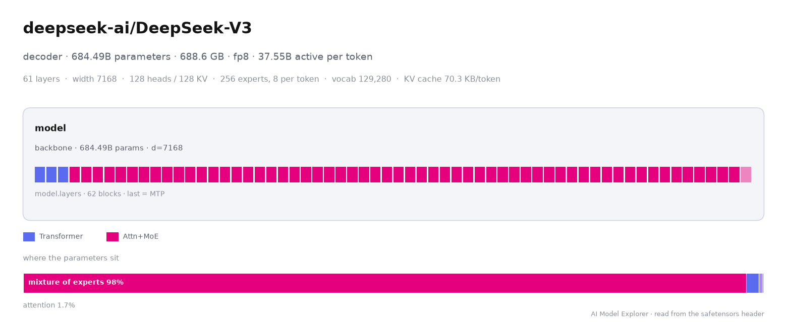

<p align="center">
  
</p>

<h1 align="center">AI Model Explorer</h1>

<p align="center"><b>See inside a Hugging Face model, part by part, from its safetensors headers alone.</b></p>

<p align="center">
  <a href="https://joessattes.github.io/ai-model-explorer/en/">Web app</a> ·
  <a href="https://github.com/JoesSattes/ai-model-explorer">GitHub</a> ·
  <a href="https://github.com/JoesSattes/ai-model-explorer/blob/main/docs/usage.md">Docs</a> ·
  <a href="https://www.researchgate.net/publication/417293353_Reading_the_Architecture_off_the_Weights_Manifest-Only_Recovery_of_Neural_Network_Anatomy">Paper</a>
</p>

`ai-model-explorer` reads the safetensors header of a model (tensor names, shapes and types, a median of 80 KB across
12,974 Hub repositories) and works out its architecture: components, repeated layers and what each one does, how the parts
connect, the exact parameter count and how every tensor is stored. Nothing else is downloaded.

```bash
pip install ai-model-explorer
```

## Command line

```bash
ai-model-explorer inspect deepseek-ai/DeepSeek-V3
```
```
deepseek-ai/DeepSeek-V3
  family decoder · 684.49B parameters · 688.6 GB of weights · stored as fp8
  read 11.9 MB from 163 file(s), 91991 tensors
  width 7168 · layers 61 · heads 128 · kv heads 128 · head dim 128 · ffn 18432 · experts 256 · active experts 8 · vocab 129280
  components:
    (root) (backbone) · d=7168
      model.layers: 62 blocks · Transformer ×3, Attn+MoE ×58, Attn+MoE ×1 (last one is a multi-token-prediction layer)
  config.json: agrees with the weights
```

| Command | What it does |
|---|---|
| `ai-model-explorer inspect MODEL` | readable summary of a Hugging Face repo, URL, `.safetensors` file or folder (`--json` for everything, `--tensors` for every tensor's role) |
| `ai-model-explorer insights MODEL` | findings in plain language: active parameters per token, where the parameters sit, KV-cache cost, tied embeddings, hybrid layers |
| `ai-model-explorer memory MODEL --context 32768 --weight-bits 4` | memory for the weights at any precision plus the KV cache |
| `ai-model-explorer compare A B C` | side-by-side table (Markdown, `--csv` or `--json`) |
| `ai-model-explorer plot MODEL -o model.png` | the anatomy diagram as PNG, SVG or PDF (`--theme dark`) |
| `ai-model-explorer report MODEL -o model.html` | one self-contained HTML report: diagram, insights, tables, memory |
| `ai-model-explorer fits MODEL rtx-4090 --context 32768` | does it fit on a device (or `24` GB)? the longest context that fits, and the cheapest precision that would make it fit (`devices` lists the names) |
| `ai-model-explorer diff A B` | what changed between two checkpoints: a fine-tune vs its base, a quantized copy vs the original, two versions |
| `ai-model-explorer scan --file repos.txt -o table.csv` | many repos into one CSV (in parallel; failures become rows with an error) |
| `ai-model-explorer ready MODEL [--submit]` | smallest device class at 4-bit weights / 8k context and five metadata checks, as on the Deploy-Ready board |
| `ai-model-explorer census MODEL` | where it sits among the Hub's popular language models, and the closest popular original releases |
| `ai-model-explorer devices` | the device names `fits` accepts |
| `ai-model-explorer open [MODEL]` | the web app on your machine (`--lang th` for Thai) |



Gated or private repos: set `HF_TOKEN` or pass `--token`. A mirror: set `HF_ENDPOINT`.

## Python

```python
from ai_model_explorer import explore, compare, compare_table

m = explore("deepseek-ai/DeepSeek-V3")
m.family, m.params, m.active_params   # 'decoder', 684489845504, 37552297472
m.hp["heads"], m.hp["kv_heads"]       # 128, 128 (from config.json, checked against the weights)
m.breakdown("kind")                   # parameters, share and bytes per part type
m.kv_cache_bytes_per_token()          # 70272 (latent attention)
m.memory(context=32768, weight_bits=4)
for line in m.insights():
    print("-", line)
m.plot("deepseek.png")                # matplotlib Figure; .png, .svg or .pdf
m.report("deepseek.html")

print(compare_table(compare(["Qwen/Qwen3-8B", "Qwen/Qwen3-30B-A3B-GPTQ-Int4"])))

from ai_model_explorer import fits, diff, scan
fits("Qwen/Qwen3-8B", "rtx-4090", context=32768)   # {'fits': True, 'max_context': ..., 'suggestion': ...}
diff("Qwen/Qwen3-8B", "Qwen/Qwen3-8B-FP8")         # [{'field': 'quantization', 'a': 'none', 'b': 'fp8'}, ...]
rows = scan(open("repos.txt").read().split())      # one dict per repo
```

`explore()` returns a `Model`; `inspect()` returns the raw dict it wraps. Every field and method is described in the
[usage guide](https://github.com/JoesSattes/ai-model-explorer/blob/main/docs/usage.md).

## Why it is useful
- **Before downloading**: the anatomy of a 689 GB checkpoint from 12 MB of headers.
- **Quantization and edge planning**: where the parameters sit, which layers keep a KV cache, how each tensor is stored (FP8, NVFP4, GPTQ, AWQ, MXFP4, MLX, bitsandbytes).
- **New architectures**: hybrid attention / state-space / mixture-of-experts stacks, multi-token-prediction layers, encoders feeding an LLM, each labeled with the evidence.
- **Comparisons and reports**: a table across many models, diagrams for slides and papers, an HTML report to share.
- **Batch analysis**: plain dicts or JSON from a single function call.

## What is new
Reading the header is standard practice; tools such as hf-mem estimate memory from it, and HF Viewer draws graphs from a model's config and code. This package interprets the header itself: components, block types and the role of every tensor without config or code (95% of roles still right with every tensor name hidden), exact logical parameter counts under quantized storage, KV cache from the weights including latent attention, and a check of `config.json` against the weights.

## How accurate is it?
On 510 architectures from the transformers library, 96.8% of tensors get the right role (82.3% for the best rule
set that reads names only, 95.0% for this method with every name replaced by a random token). Parameter totals
are exact for all 510, including FP8, NVFP4 and GPTQ storage. On 191 popular Hugging Face checkpoints, totals agree
with the Hub's own count for 149 of the 158 transformers-style checkpoints that show a count (allowing for the 0-d
scalars the Hub skips); 5 of the 9 differences are packed 4-bit releases where the Hub counts packed storage.

## How it runs
The analysis is the same JavaScript that powers the website (`infer.js`, `loaders.js`), run in an embedded QuickJS
engine, so the Python and web results match. Python 3.9+, two dependencies (`quickjs`, and `matplotlib` for diagrams), no PyTorch or transformers.
A typical model takes well under a second. Headers of a sharded model are fetched in parallel, and each repo commit's
headers are cached (`~/.cache/ai-model-explorer`, or `$AME_CACHE`; `cache=False` or `AME_NO_CACHE=1` to skip). If Node.js
is installed, large manifests are analyzed with it (DeepSeek-V3: about 5 s instead of 15; `AME_JS=quickjs` to opt out).

## Citation
Sattaya Singkul. 2026. *Reading the Architecture off the Weights: Manifest-Only Recovery of Neural Network Anatomy.*
Preprint, [ResearchGate](https://www.researchgate.net/publication/417293353_Reading_the_Architecture_off_the_Weights_Manifest-Only_Recovery_of_Neural_Network_Anatomy).

MIT License © 2026 Sattaya Singkul
